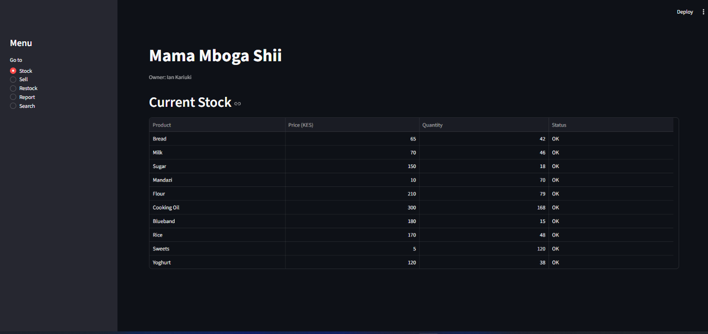

# Kiosk Manager


An inventory and sales management system for a small Nairobi kiosk, written in Python. It began as a single-file command-line capstone and was rebuilt with classes, services and a package structure, then given a web interface using Streamlit.



The same core code powers both versions: a terminal menu (`main.py`) and a web app (`app.py`).

## Features

- **Inventory management**: view stock, restock existing products, add new ones
- **Selling**: stock is checked before every sale, so the kiosk can never oversell
- **Customers**: every sale is tied to a customer, with running total spend tracked per person
- **Employees**: every sale records who served the customer, with employee totals and a top-employee line
- **Sales report**: total revenue, products sold, best seller, a units-sold chart, and a full sales table
- **Search**: case-insensitive, partial-match product search
- **Low-stock alerts**: low products are highlighted, with a warning banner on the web and a `restock_alerts.txt` file from the terminal version
- **Remembered setup**: kiosk name and owner are asked once, then loaded automatically
- **Persistence**: inventory and sales history survive between runs, and customer and employee totals are rebuilt on startup
- **Input validation**: bad input never crashes the program

## Project structure

```
kiosk_manager_v/
├── app.py                  # web interface (Streamlit)
├── main.py                 # terminal interface
├── requirements.txt
├── models/
│   ├── product.py          # Product: owns its own stock logic
│   ├── customer.py         # Customer: tracks total spent
│   ├── employee.py         # Employee: tracks sales handled
│   └── sale.py             # Sale: one transaction (product, customer, employee)
├── services/
│   ├── inventory.py        # Inventory: manages the collection of products
│   └── sales.py            # SalesService: sales log, customers, employees, reports
└── utils/
    ├── validation.py       # reusable input-cleaning and validation helpers
    └── kiosk_settings.py   # save and load the kiosk name and owner
```

**Design idea:** `models/` holds single objects that know only about themselves. `services/` coordinates collections of those objects and holds the business logic. `main.py` and `app.py` are two front ends on top of the same services, so the web page and the terminal menu never duplicate logic.

## How to run

Requires Python 3.

**Web version**

```
pip install -r requirements.txt
python -m streamlit run app.py
```

This opens the app in your browser at `localhost:8501`. On first run it asks for the kiosk name and owner.

**Terminal version**

```
python main.py
```

Run both from the project root. Files in `models/`, `services/` and `utils/` are imported by the two front ends and are not meant to be run directly.

## Data files

Created automatically when you use the program. They are not included in the repository.

| File | Purpose |
|------|---------|
| `inventory.txt` | current stock |
| `sales_history.txt` | every sale ever made, one line per sale |
| `kiosk.txt` | kiosk name and owner, asked once on first run |
| `restock_alerts.txt` | low-stock list written by the terminal version on exit |

## Skills demonstrated

Classes and objects, encapsulation, composition, single responsibility, packages and imports, dictionaries, lists, tuples, sets, string handling, file reading and writing, input validation, separating logic from presentation, building a web interface with Streamlit, and debugging.

## Author

Ian Waweru Kariuki
